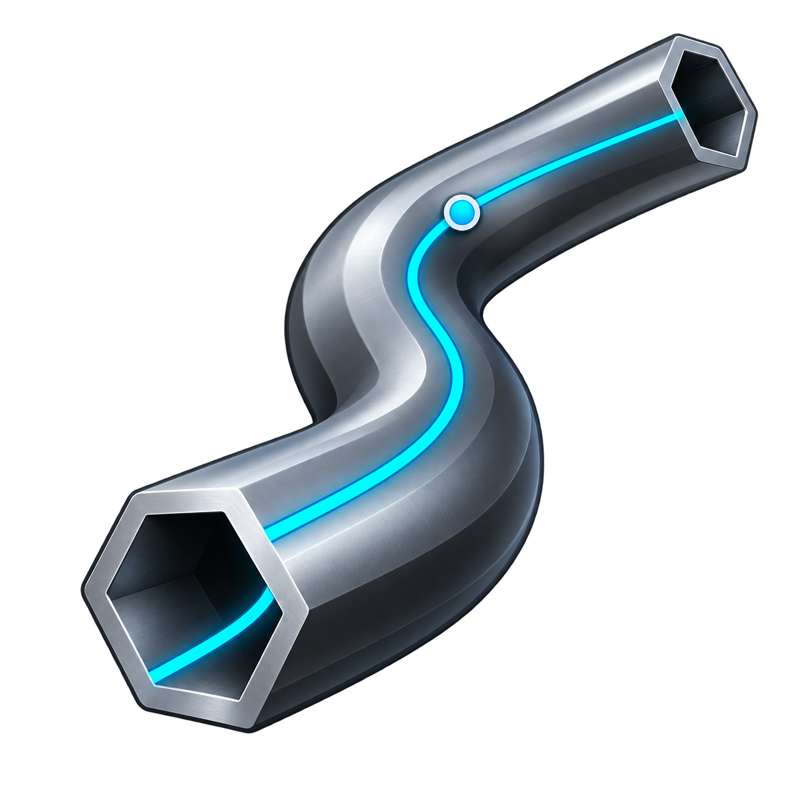

# Pipe Studio



Pipe Studio is a new RhinoCommon plugin for creating architectural members along path curves. It targets **Rhino 7 and Rhino 8 on macOS and Windows** with a shared Eto interface and AnyCPU assemblies.

**Status: 0.10 alpha prerelease.** The current prerelease is on [GitHub](https://github.com/KnuckKnuck0123/PipeStudio/releases/tag/v0.10.0-alpha.3) and Rhino Package Manager. It adds custom profiles and multiple taper stations. Host checks in [docs/TESTING.md](docs/TESTING.md) are still being completed. Future ideas are in [docs/ROADMAP.md](docs/ROADMAP.md).

## Profiles and controls

- Circle, triangle, square, rectangle, and regular polygons with 3–128 sides.
- C stud with optional return lips (zero lip makes a channel), I beam, and L/angle sections.
- Common US dressed lumber presets from 1x2 to 6x6. A 2x4 uses an actual 1.5 × 3.5 inch section, converted to the document's standard model units.
- Width/diameter, depth, material thickness, stud lip, polygon sides, and section rotation.
- Start and end scale for tapered members; 1 means the entered dimensions. Scaling affects the entire section, including material thickness. Values must stay positive; apex taper to zero is not supported. Closed rails require equal scales.
- Optional intermediate taper stations use `position:scale` pairs along rail length, such as `0.25:0.5, 0.5:1, 0.75:0.5`. Positions are fractions from 0 to 1, between the start and end scale controls.
- Custom profiles use one closed planar Rhino curve for a solid section, or two nested closed coplanar curves for a hollow section. The resulting member is fixed when created; editing the source curves afterward does not update it.
- Viewport preview, optional shading, optional end caps, and creation in one undo record. Original path curves are preserved.

These are idealized geometric sections with sharp corners. Steel sizes are custom dimensions, not an engineering or manufacturer catalog; fillets, rated capacities, connection details, automatic joint trimming, and hollow tube walls are not included. Circular members are solid pipe shapes when capped. Lumber presets describe common US surfaced dimensions.

## Use

### Test without installing a package

In Rhino, run `RunPythonScript` and select `scripts/TestPipeStudio.py`. This loads the compiled DLL and opens the panel directly, without registering a plugin or installing a Yak package. Use a scratch model: **Create members** adds real objects, while **Cancel** adds none. Restart Rhino after rebuilding because loaded .NET assemblies remain in memory. For separate geometry checks, run `tests/rhino_smoke.py`; it uses a disposable headless document.

### Load the registered command

1. Load the appropriate `PipeStudio.rhp` through Rhino's plugin manager, or drag the file into Rhino. For Rhino 7 use the `net48` build; for Rhino 8's default .NET runtime use `net7.0`. Rhino 8 Windows running the legacy .NET Framework runtime uses `net48`.
2. Run `PipeStudio`.
3. Click **Select path curves…** and select up to 2,000 curves. For batches over 200, the viewport previews the first 200; **Create** processes every selected curve.
4. Choose a profile and dimensions. Review the preview, rotation, taper, and caps.
   For **Custom curve**, click **Select profile curve(s)…** and pick the outer curve, then optionally an inner curve. Press Enter after picking only one curve. For repeated grow/shrink taper, enter intermediate `position:scale` pairs in ascending order.
5. Click **Create members**. If a rail fails, the panel identifies skipped rails and offers creation of the valid members. Cancel clears the preview without adding objects.

Sections are centered on rails. The initial orientation comes from Rhino's perpendicular frame, with an additional rotation around the rail. Curved and closed rails can twist or fail at tight bends; use the preview to inspect the result. Taper follows rail direction: reverse the curve to swap its start and end.

For local Yak testing, use the distribution matching your Rhino major version from `build/packages/`. Rhino's Yak CLI accepts `yak install <path-to-package.yak>`; restart Rhino and run `PipeStudio`. Installation is a separate, explicit action.

## Build

Requires a .NET SDK supporting compilation of `net48` and `net7.0`, internet access for the initial NuGet restore, and Python 3 for packaging. Framework reference assemblies allow compilation of `net48` on macOS without a Windows installation. Running the plugin requires Rhino.

```sh
dotnet build PipeStudio.csproj -c Release --disable-build-servers --maxcpucount:1 /p:UseSharedCompilation=false
python3 scripts/build_package.py --no-build
```

On Windows, use `py -3 scripts/build_package.py --no-build` if Python is available through the launcher. Running the script without `--no-build` builds first.

Outputs:

```text
bin/Release/net48/PipeStudio.rhp
bin/Release/net7.0/PipeStudio.rhp
build/packages/PipeStudio-0.10.0-alpha.3-rh7_0-any.yak
build/packages/PipeStudio-0.10.0-alpha.3-rh8_0-any.yak
```

The Rhino 7 distribution contains the `net48` plugin at the package root. The Rhino 8 distribution contains `net48/` and `net7.0/` folders so Rhino selects the matching runtime. Packages contain PipeStudio, its manifest, icon, readme, and MIT license; Rhino supplies RhinoCommon, Rhino.UI, and Eto.

The project pins RhinoCommon 7.0.20314.3001 for `net48`, RhinoCommon 8.0.23304.9001 for `net7.0`, and Eto.Forms 2.5.3. The baseline Rhino 8 NuGet package exposes .NET Framework reference assets, so NuGet may emit NU1701 for the .NET 7 target. This is a build compatibility warning to track during host validation.

## Developer references

- [Rhino cross-platform SDK](https://developer.rhino3d.com/guides/rhinocommon/what-is-rhinocommon/)
- [Rhino .NET runtime and AnyCPU guidance](https://developer.rhino3d.com/guides/rhinocommon/moving-to-dotnet-core/)
- [Yak package format and distribution tags](https://developer.rhino3d.com/guides/yak/the-anatomy-of-a-package/)
- [Rhino 8 multi-target package layout](https://developer.rhino3d.com/guides/yak/creating-a-multi-targeted-rhino-plugin-package/)
